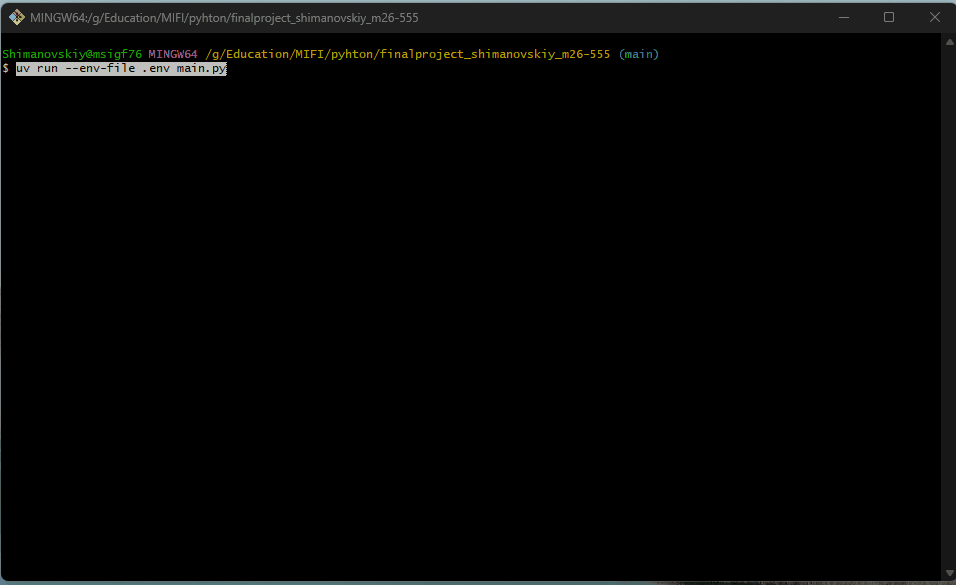

Итоговый проект по Python finalproject_shimanovskiy_m26-555
Консольное приложение валютного кошелька ValutaTrade Hub, предоставаляет возможность:
- регистрации и входа,
- создания и ведение портфелей из кошельков в разных валютах и криптовалютах
- покупку и продажу валюты и криптовалюты
- актульные курсы валют и криптовалют
- обновление курсов вручную ('update-rates') или по таймеру ('start-scheduler')
- логирование операций и работы парсера с ротацией файлов

# Библиотеки и зависимости:
uv run ruff check .      # проверка стиля
uv run ruff format .     # автоформатирование

# Приложение состоит из двух основных сервисов:
Основной Сервис (Core Service): 
пользователи, кошельки, сделки, пользовательский интерфейс CLI 

Сервис Парсинга (Parser Service): 
тдельный модуль, который собирает курсы из внешних API
(CoinGecko и ExchangeRate-API) и складывает их в локальный кеш

# Структура проекта:
finalproject_shimanovskiy_m26-555/
├── data/
│   ├── users.json              # пользователи
│   ├── portfolios.json         # портфели и кошельки
│   ├── rates.json              # курсы валют
│   └── exchange_rates.json     # история замеров (Parser Service)
├── logs/                       # actions.log, parser.log (не хранятся в github)
├── valutatrade_hub/
│   ├── logging_config.py       # настройка логов: формат, уровень, ротация
│   ├── decorators.py           # @log_action (логирование операций)
│   ├── core/
│   │   ├── currencies.py       # Базовый класс Currency и наследники Fiat/Crypto
│   │   ├── exceptions.py       # Пользовательские исключения
│   │   ├── models.py           # реализация классов  User, Wallet, Portfolio
│   │   ├── usecases.py         # бизнес-логика команд
│   │   └── utils.py            # спомогательные функции, сериализация, валидаторы, получение курса
│   ├── infra/
│   │   ├── settings.py         # SettingsLoader (singleton)
│   │   └── database.py         # DatabaseManager (singleton)
│   ├── parser_service/			# отдельный модуль, который собирает курсы из внешних API
│   │   ├── config.py           # ParserConfig API: URL, списки валют, ключ из .env
│   │   ├── api_clients.py      # работа с внешними API, CoinGeckoClient, ExchangeRateApiClient
│   │   ├── updater.py          # основной модуль обновления курсов
│   │   ├── storage.py          # операции чтения/записи rates.json и exchange_rates.json
│   │   └── scheduler.py        # планировщик периодического обновления в фоне
│   └── cli/
│       └── interface.py        # командный интерфейс
├── main.py                     # точка входа
├── pyproject.toml
├── uv.lock
└── README.md

# Установка:
git clone https://github.com/<логин>/<репозиторий>.git
cd <репозиторий>
uv sync

# Установка как пакета
uv build
uv tool install dist/<файл>.whl
valutatrade

# Запуск и работа с приложением:
uv run main.py
# для запуска Parser Service с реальными курсами, запускается с ключем
# 1. зарегистрироватся на <https://www.exchangerate-api.com/> и получите ключ.
# 2. создать в корне проекта файл `.env` (он добавлен в `.gitignore` и не попадает в репозиторий)
# 3. указать ключ в файле EXCHANGERATE_API_KEY=ваш_ключ
# 4. запуск приложения с этим файлом
uv run --env-file .env main.py
# Без ключа работает только CoinGecko, те только криптовалюты

# Список команд прилодения:
register --username <имя> --password <пароль> 	#(регистрация и создания пользователя с паролем от 4 символов)
login --username <имя> --password <пароль> 		#(авторизация)
show-portfolio 									#(показывает кошельки и итог в базовой валюте (по умолчанию USD))
show-portfolio --base <валюта> 					#(показывает кошелек определенной валюты)
buy --currency <код> --amount <число> 			#(покупка валюты)
sell --currency <код> --amount <число>			#(продажа валюты)
get-rate --from <код> --to <код>				#(курс пары и обратный курс)
list-currencies									#(список поддерживаемых валют)
update-rates --source coingecko\|exchangerate   #(обновляет кеш курсов из внешних API)
show-rates  									#(курсы из локального кеша)
start-scheduler --interval <секунды>			#(запуск автообновление курсов)
stop-scheduler									#(остановка автообновление)
help, exit										#(справка и выход)

# Примеры команд
> register --username ivan --password 1234
Пользователь 'ivan' зарегистрирован (id=1). Войдите: login --username ivan --password ****
> login --username ivan --password 1234
Вы вошли как 'ivan'
> buy --currency BTC --amount 0.05
Покупка выполнена: 0.0500 BTC по курсу 59337.21 USD/BTC
Изменения в портфеле:
- BTC: было 0.0000 → стало 0.0500
Оценочная стоимость покупки: 2,966.86 USD
> show-portfolio
Портфель пользователя 'ivan' (база: USD):
- BTC: 0.0500  → 2,966.86 USD
> get-rate --from USD --to XYZ
Неизвестная валюта 'XYZ'
Поддерживаемые валюты: BTC, ETH, EUR, GBP, RUB, SOL, USD
Подробности о валютах: list-currencies
> update-rates
INFO: Starting rates update...
INFO: Fetching from CoinGecko... OK (3 rates)
INFO: Fetching from ExchangeRate-API... OK (3 rates)
INFO: Writing 6 rates to data/rates.json...
Update successful. Total rates updated: 6. Last refresh: 2026-11-06 13:05:44

# Кеш и TTL

Core Service не обращается к внешним API при каждой команде, а читает локальный
кеш (data/rates.json)

# Демо запись gif
